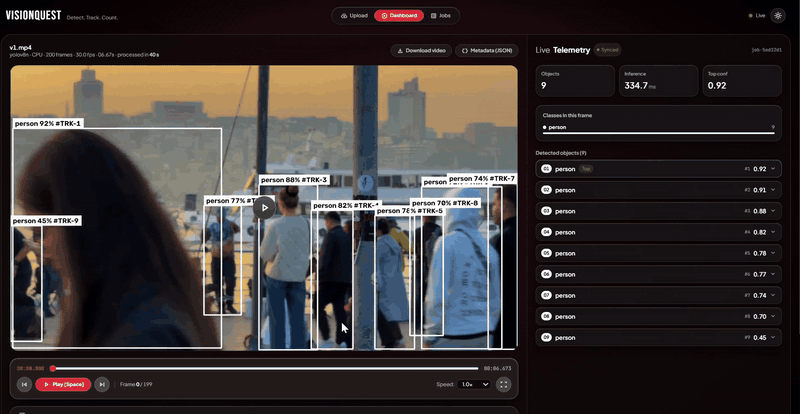
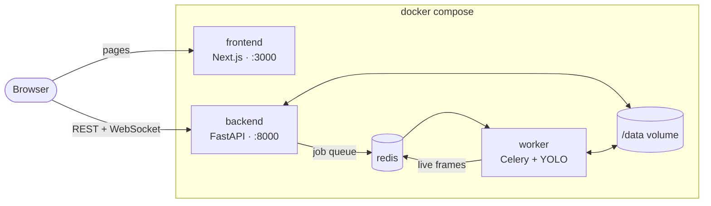

# VisionQuest

Detect. Track. Count.

VisionQuest is a web app for running YOLO models on your own images and videos. You upload a file,
pick a model, and it gets processed in the background. When it's done you get the annotated video
with a sidebar that follows along frame by frame: what was detected, how confident the model was,
and how long the frame took.



## What it does

- Upload JPG/PNG images or MP4/AVI/MOV videos, choose a model and a confidence threshold.
- Jobs run in a background worker. While one runs, the upload page shows live preview frames.
- The dashboard plays the result with the usual controls plus frame stepping, and the sidebar stays
  in sync with the video. The most confident object in each frame is highlighted.
- Objects keep the same ID across frames (ByteTrack), and a strip of keyframes jumps to the busiest
  moments.
- A jobs page lists everything you've run, with search and filters.
- It uses an NVIDIA GPU when one is available and falls back to CPU otherwise.

| Model | Use it for |
|---|---|
| `yolov8n` (default) | Fast object detection, 80 everyday classes |
| `yolov8s` | Same, slower but more accurate |
| `yolov8s-worldv2` | Finding whatever you type, e.g. `forklift, helmet` |
| `yolov8n-seg` | Detection plus segmentation masks |

<table>
  <tr>
    <td></td>
    <td></td>
  </tr>
  <tr>
    <td></td>
    <td></td>
  </tr>
</table>

## How it fits together



The browser loads pages from the frontend but calls the backend directly. An upload is saved to a
shared volume and its job ID goes onto a Redis queue. The worker, which is the same image as the
backend with a different start command, picks it up, runs the model and writes the results next to
the upload. While it works it publishes preview frames through Redis, and the backend forwards them
to the browser over a WebSocket.

```text
/data/
  jobs.db                         # job records (SQLite)
  uploads/{job_id}/input.mp4
  results/{job_id}/output.mp4     # output.jpg for images
  results/{job_id}/metadata.json
```

## Getting started

You need Docker with Compose v2, about 6 GB of free disk and ideally 8 GB of RAM for Docker. A GPU is
optional.

```bash
git clone https://github.com/RakshithDasari/internship_assignment-.git visionquest
cd visionquest
docker compose up --build
```

The first build takes 10 to 15 minutes, mostly downloading PyTorch and the model weights. Once
`docker compose ps` shows all four services as healthy, open http://localhost:3000.

With an NVIDIA GPU, add the override file:

```bash
docker compose -f docker-compose.yml -f docker-compose.gpu.yml up --build
```

[docs/setup.md](docs/setup.md) covers health checks, running without Docker and troubleshooting.

## Configuration

Everything has a default, so a `.env` file is optional. To change something, copy `.env.example` to
`.env`.

| Variable | Default | What it does |
|---|---|---|
| `MAX_FILE_SIZE_MB` | `500` | Largest upload accepted |
| `ALLOWED_EXTENSIONS` | `mp4,avi,mov,jpg,jpeg,png` | Accepted file types |
| `DEFAULT_MODEL` | `yolov8n` | Model used when none is chosen |
| `DEFAULT_CONFIDENCE` | `0.45` | Confidence threshold when none is chosen |
| `LOG_LEVEL` | `INFO` | Log level for the backend and worker |
| `CORS_ORIGINS` | `http://localhost:3000` | Browser origins allowed to call the API |
| `NEXT_PUBLIC_API_BASE_URL` | `http://localhost:8000` | API address the browser uses (baked in at build, so rebuild after changing it) |
| `REDIS_URL` | `redis://redis:6379/0` | Redis connection |
| `DATA_DIR` | `/data` | Where uploads, results and the job database live |
| `WEIGHTS_DIR` | `/weights` | Where model weights live |

Inside Docker, Compose sets the last three itself. They matter when you run the backend natively.

## API

Interactive docs are at http://localhost:8000/docs. Errors always come back as
`{"detail": "...", "code": "..."}`.

| Method | Endpoint | What it does |
|---|---|---|
| `POST` | `/upload` | Upload a file and start a job. Fields: `file`, `model`, `conf`, `prompt` (for YOLO-World), `device` (`auto`/`cpu`/`gpu`) |
| `GET` | `/jobs` | List all jobs, newest first |
| `GET` | `/jobs/{job_id}` | Job status and progress |
| `GET` | `/jobs/{job_id}/result` | The annotated video or image (supports seeking) |
| `GET` | `/jobs/{job_id}/metadata` | Metadata for every frame |
| `GET` | `/jobs/{job_id}/metadata/{frame}` | Metadata for one frame |
| `POST` | `/jobs/{job_id}/cancel` | Cancel a queued job |
| `DELETE` | `/jobs/{job_id}` | Delete a job and its files |
| `GET` | `/models` | Available models |
| `GET` | `/health` | Status of the API, Redis, worker and ffmpeg |
| `WS` | `/ws/jobs/{job_id}` | Live progress and preview frames |

```bash
curl -F "file=@street.mp4" -F "model=yolov8n" http://localhost:8000/upload
# {"job_id":"17fa90174fc748698ae5246216934af0","status":"queued"}

curl http://localhost:8000/jobs/17fa90174fc748698ae5246216934af0
curl http://localhost:8000/jobs/17fa90174fc748698ae5246216934af0/metadata/42
curl -o annotated.mp4 http://localhost:8000/jobs/17fa90174fc748698ae5246216934af0/result
```

Each frame's metadata looks like this (one detection shown):

```json
{
  "frame_index": 42,
  "timestamp_ms": 1401,
  "model": "yolov8n",
  "detections": [
    {
      "class_id": 0,
      "class_name": "person",
      "confidence": 0.8183,
      "bbox": { "x1": 1200, "y1": 1566, "x2": 1563, "y2": 2150 },
      "mask_present": false,
      "track_id": 10
    }
  ],
  "total_objects": 8,
  "inference_time_ms": 74.8
}
```

## Tests

The backend has 27 tests covering 85% of the code. They run the real models on real images and don't
need Docker:

```bash
cd backend
python -m pytest --cov=app
```

Setup steps and the manual test plan are in [docs/testing.md](docs/testing.md).

## Performance

For a 6.7-second 4K clip (200 frames) with `yolov8n`:

| Setup | Total time |
|---|---|
| Docker, laptop CPU | 39 s (about 63 ms of model time per frame) |
| Docker, NVIDIA GPU | under 15 s |

Output video is scaled down to 1080p so it plays smoothly in the browser.

## Why these choices

- I used Next.js instead of React with Vite. It's what I'm most comfortable with, and its standalone
  output makes a small Docker image. That's also why the frontend variable is
  `NEXT_PUBLIC_API_BASE_URL` instead of `VITE_API_BASE_URL`.
- Celery and Redis keep the heavy inference out of the API process, so the API stays responsive. The
  same Redis carries the live preview frames.
- Job records live in SQLite, and each job's frame metadata is a plain JSON file that can be served
  or downloaded as-is.
- Model weights are downloaded while the image is built, so the first job doesn't wait for them.
- The frontend image uses Node 22 rather than 20, since Node 20 has reached end of life.
- I chose YOLO-World and YOLOv8-Seg over SAM 2. They run in the same Ultralytics pipeline, work on
  CPU, and between them cover open-vocabulary detection and segmentation.

## Limitations

- There are no user accounts, so anyone who can open the app sees every job. It's meant to run
  locally.
- Jobs run one at a time, and on CPU a long video can take a few minutes.
- GPU support in Docker is NVIDIA only. My Intel Arc GPU works when the app runs natively, but Docker
  Desktop can't pass it into containers.
- Old jobs aren't cleaned up automatically. Delete them from the Jobs page.
- Tracking IDs can switch when objects cross paths or disappear for a while.

If I keep working on it, the next steps would be user accounts, more than one worker, automatic
cleanup of old jobs, and hosting it online over HTTPS.

## Project layout

```text
backend/
  app/
    api/routes.py     # REST endpoints and the WebSocket
    models/           # model registry, inference, drawing, video I/O
    workers/          # Celery app and the processing task
    config.py, db.py, main.py
  tests/
frontend/
  src/app/            # pages: intro, upload, jobs, dashboard
  src/components/
  src/lib/            # API client, hooks, frame-sync helpers
docker-compose.yml    # redis, backend, worker, frontend
docker-compose.gpu.yml
docs/                 # setup guide and test plan
```
