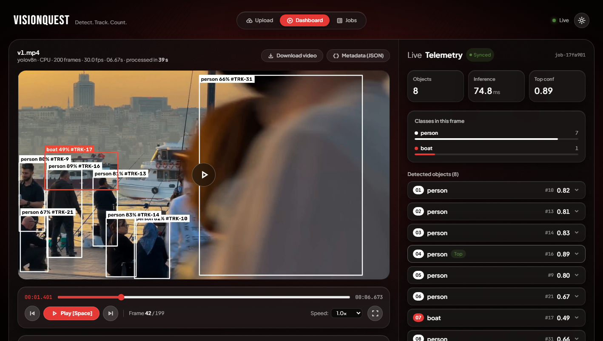
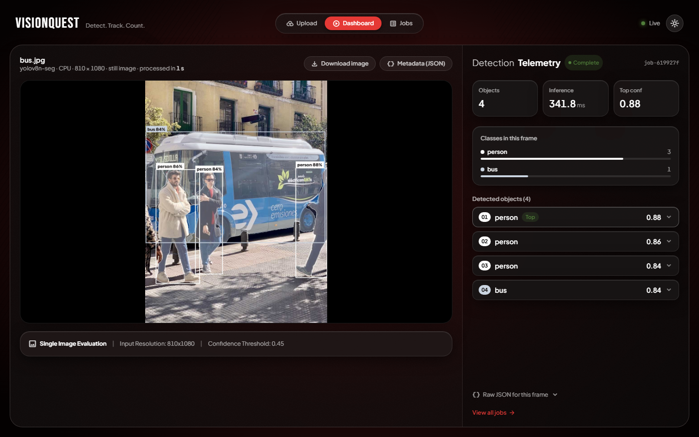
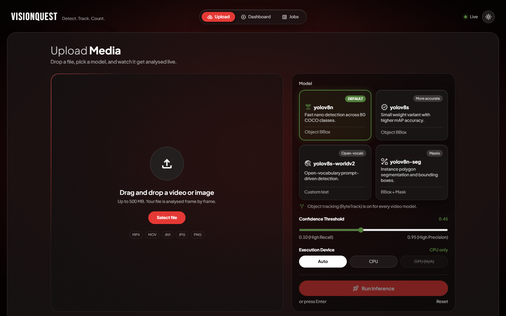
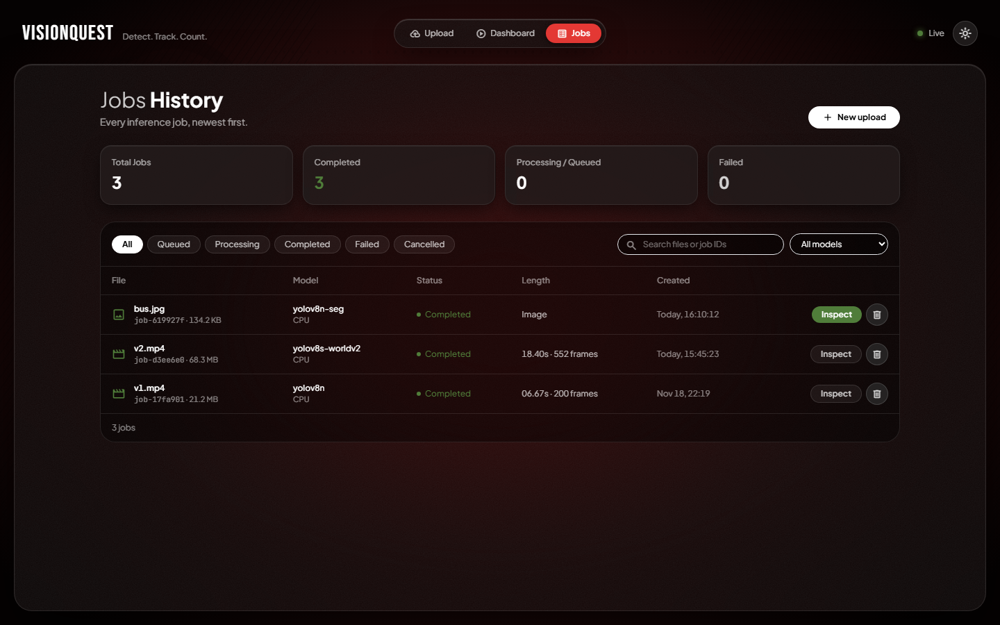
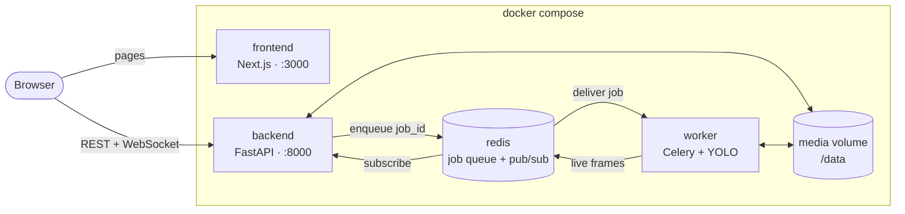

# VisionQuest — Detect. Track. Count.

Upload an image or video, choose a YOLO model, and watch it get analysed. VisionQuest runs
inference asynchronously, tracks objects across frames, and plays the annotated result next to a
sidebar of per-frame detections that stays in sync with the video.


## Contents

- [Overview](#overview)
- [Architecture](#architecture)
- [Prerequisites](#prerequisites)
- [Quick start](#quick-start)
- [Configuration](#configuration)
- [API reference](#api-reference)
- [Running tests](#running-tests)
- [Performance](#performance)
- [Design decisions](#design-decisions)
- [Known limitations and future work](#known-limitations-and-future-work)
- [Project structure](#project-structure)

Further docs: [docs/setup.md](docs/setup.md) (setup, health checks, troubleshooting) ·
[docs/testing.md](docs/testing.md) (manual test plan and automated tests).

## Overview

**Supported models** (all from Ultralytics; selectable per upload):

| Model | Task | Notes |
|---|---|---|
| `yolov8n` (default) | Object detection | Fastest; 80 COCO classes |
| `yolov8s` | Object detection | More accurate, slower |
| `yolov8s-worldv2` | Open-vocabulary detection | Detects whatever you type, e.g. `forklift, helmet` |
| `yolov8n-seg` | Detection + instance segmentation | Draws masks; `mask_present: true` in metadata |

**What it does**

- **Upload** images (JPG, PNG) or videos (MP4, AVI, MOV) by drag and drop, with upload progress,
  a confidence slider and a device choice (auto, CPU, GPU).
- **Asynchronous processing**: the upload returns a `job_id` at once; a Celery worker runs the model
  frame by frame. AVI/MOV and other codecs are converted to browser-playable H.264.
- **Live progress**: the upload page streams annotated preview frames over a WebSocket while the job
  runs (it falls back to polling `GET /jobs/{id}`).
- **Dashboard**: the annotated video with play, pause, seek, speed, frame stepping and a frame
  counter. The sidebar shows the current frame's objects, classes, confidences and inference time,
  highlights the most confident detection, and charts objects per class. Images get the same
  sidebar without playback controls.
- **Tracking**: ByteTrack gives each object a consistent ID across frames (`#TRK-7`).
- **Keyframes**: a thumbnail strip of the frames with the most detections; click one to jump there.
- **Jobs history**: every job with status, model, file and type, length, and a link to its
  dashboard; filter, search, cancel queued jobs, delete finished ones.
- **GPU support with graceful fallback**: CUDA (NVIDIA, via a Compose override) or Intel XPU (native
  runs), falling back to CPU when no GPU is available.

<table>
  <tr>
    <td></td>
    <td></td>
  </tr>
  <tr>
    <td align="center">Video dashboard: tracking IDs and the synced sidebar</td>
    <td align="center">Image dashboard: segmentation with <code>yolov8n-seg</code></td>
  </tr>
  <tr>
    <td></td>
    <td></td>
  </tr>
  <tr>
    <td align="center">Upload and model selection</td>
    <td align="center">Jobs history</td>
  </tr>
</table>

## Architecture



1. The browser loads the UI from `frontend` and talks to `backend` directly (REST for uploads and
   results, a WebSocket for live progress).
2. `POST /upload` validates the file, saves it to the shared volume, records the job in SQLite and
   puts the job ID on the Redis queue.
3. The `worker` (same image as `backend`, different command) takes the job, runs the model frame by
   frame, writes the annotated output and `metadata.json`, and publishes live preview frames to Redis,
   which `backend` relays to the browser.
4. Files never pass through Redis; both services share the `/data` volume:

```text
/data/
  jobs.db                              # job records (SQLite)
  uploads/{job_id}/input.mp4
  results/{job_id}/output.mp4          # output.jpg for images
  results/{job_id}/metadata.json
  results/{job_id}/thumbs/{frame}.jpg  # keyframe thumbnails
```

Compose starts the services in order using health checks: `redis` → `backend` and `worker` →
`frontend`.

## Prerequisites

| | Requirement |
|---|---|
| Docker | Docker Desktop (Windows/macOS) or Docker Engine (Linux) with Compose v2 |
| Disk | About **6 GB** for the CPU build (images ~4.3 GB plus build cache); about **12 GB** with the NVIDIA override |
| Memory | 4 GB free RAM minimum, 8 GB recommended (Docker Desktop: Settings → Resources) |
| GPU (optional) | NVIDIA GPU, a driver supporting CUDA 13.2+, Docker GPU support. Without one, everything runs on CPU |
| Network | Needed for the first build (base images, PyTorch, model weights) |

## Quick start

```bash
git clone https://github.com/RakshithDasari/internship_assignment-.git visionquest
cd visionquest
docker compose up --build
```

No `.env` is needed: every setting has a default. The first build takes about 10–15 minutes (most of
it downloading PyTorch and the model weights); later builds reuse the cache.

When `docker compose ps` shows all four services as `healthy`, open **http://localhost:3000**. The
intro plays, then the upload page opens. The API is at http://localhost:8000 (`/health` for a quick
check).

**With an NVIDIA GPU:**

```bash
docker compose -f docker-compose.yml -f docker-compose.gpu.yml up --build
```

This installs the CUDA build of PyTorch and gives the GPU to the containers. Expect a longer first
build (about 3–4 GB of CUDA libraries). See [docs/setup.md](docs/setup.md) for checking GPU access,
stopping and cleanup, running without Docker, and troubleshooting.

## Configuration

Copy `.env.example` to `.env` to override any of these; Compose reads it automatically. Rebuild after
changing `NEXT_PUBLIC_API_BASE_URL`, because it is compiled into the frontend.

| Variable | Default | Purpose |
|---|---|---|
| `MAX_FILE_SIZE_MB` | `500` | Largest accepted upload |
| `ALLOWED_EXTENSIONS` | `mp4,avi,mov,jpg,jpeg,png` | Accepted file types |
| `DEFAULT_MODEL` | `yolov8n` | Model used when the upload doesn't name one |
| `DEFAULT_CONFIDENCE` | `0.45` | Confidence threshold when the upload doesn't set one |
| `LOG_LEVEL` | `INFO` | Backend and worker log level |
| `CORS_ORIGINS` | `http://localhost:3000` | Comma-separated browser origins allowed to call the API (also checked for WebSockets) |
| `NEXT_PUBLIC_API_BASE_URL` | `http://localhost:8000` | API address as the browser sees it (build time) |
| `REDIS_URL` | `redis://redis:6379/0` | Redis connection |
| `DATA_DIR` | `/data` | Uploads, results and the job database |
| `WEIGHTS_DIR` | `/weights` | Model weights |

Inside Docker, Compose sets `REDIS_URL`, `DATA_DIR` and `WEIGHTS_DIR` itself; they matter when running
the backend natively (see [docs/setup.md](docs/setup.md#6-running-without-docker)). When hosting on a
server, set `CORS_ORIGINS` and `NEXT_PUBLIC_API_BASE_URL` to the server's address.

## API reference

Interactive docs are served at http://localhost:8000/docs. Errors always use one shape:

```json
{ "detail": "Unsupported file format. Please upload AVI, JPEG, JPG, MOV, MP4, PNG.", "code": "UNSUPPORTED_TYPE" }
```

| Method | Endpoint | Description |
|---|---|---|
| `POST` | `/upload` | Upload a file and start a job. Form fields: `file` (required), `model`, `conf` (0.01–1), `prompt` (comma-separated, required for `yolov8s-worldv2`), `device` (`auto`/`cpu`/`gpu`). Returns `202 {"job_id", "status": "queued"}` |
| `GET` | `/jobs` | All jobs, newest first |
| `GET` | `/jobs/{job_id}` | Job status: `queued`, `processing`, `completed`, `failed` or `cancelled`, plus progress, queue position, timings and errors |
| `GET` | `/jobs/{job_id}/result` | Annotated MP4 or JPEG. Supports HTTP range requests (seeking); `?download=true` saves it as a file |
| `GET` | `/jobs/{job_id}/metadata` | All frame metadata; `?download=true` to save |
| `GET` | `/jobs/{job_id}/metadata/{frame}` | Metadata for one frame |
| `GET` | `/jobs/{job_id}/thumbs/{frame}` | Keyframe thumbnail (JPEG) |
| `POST` | `/jobs/{job_id}/cancel` | Cancel a queued job |
| `DELETE` | `/jobs/{job_id}` | Delete a job and its files (not while processing) |
| `GET` | `/models` | Available models, defaults, and whether a GPU is available |
| `GET` | `/health` | API, Redis, worker and ffmpeg status, and the inference device |
| `WS` | `/ws/jobs/{job_id}` | Live job stream: a status snapshot, then preview frames and status changes |

**Examples**

```bash
# Upload a video with the default model
curl -F "file=@street.mp4" http://localhost:8000/upload
# {"job_id":"17fa90174fc748698ae5246216934af0","status":"queued"}

# Open-vocabulary detection with a prompt and a higher threshold
curl -F "file=@warehouse.jpg" -F "model=yolov8s-worldv2" -F "prompt=forklift, pallet" -F "conf=0.3" \
     http://localhost:8000/upload

# Poll until "status" is "completed"
curl http://localhost:8000/jobs/17fa90174fc748698ae5246216934af0

# Frame 42's detections, the full metadata, and the annotated video
curl http://localhost:8000/jobs/17fa90174fc748698ae5246216934af0/metadata/42
curl -o metadata.json http://localhost:8000/jobs/17fa90174fc748698ae5246216934af0/metadata
curl -o annotated.mp4 http://localhost:8000/jobs/17fa90174fc748698ae5246216934af0/result

# Models and health
curl http://localhost:8000/models
curl http://localhost:8000/health
```

**Frame metadata** (`/metadata/{frame}`, one entry of `frames` in `/metadata`), shown with one of
its eight detections:

```json
{
  "frame_index": 42,
  "timestamp_ms": 1401,
  "model": "yolov8n",
  "detections": [
    {
      "class_id": 0,
      "class_name": "person",
      "confidence": 0.8183,
      "bbox": { "x1": 1200, "y1": 1566, "x2": 1563, "y2": 2150 },
      "mask_present": false,
      "track_id": 10
    }
  ],
  "total_objects": 8,
  "inference_time_ms": 74.8
}
```

Boxes are in the original video's pixel coordinates. `/metadata` also returns video-level fields
(`fps`, `frame_count`, `duration_ms`, size, device), `keyframes` and per-class `class_colors`.

## Running tests

The backend has 27 automated tests with **85% coverage**. They run the real models on real images,
need no Docker or Redis, and take under a minute:

```bash
cd backend
python -m pytest --cov=app
```

They need a Python 3.11 environment with the backend dependencies and `ffmpeg` on `PATH` (setup in
[docs/testing.md](docs/testing.md#automated-backend-tests)). The manual end-to-end test plan is in
[docs/testing.md](docs/testing.md#manual-test-plan).

## Performance

`v1.mp4`: a 6.7-second 4K clip (200 frames), `yolov8n`, default settings.

| Setup | Device | Total processing time | Model time per frame (median) |
|---|---|---|---|
| Docker on a laptop | CPU | 39 s (5.1 frames/s) | 63 ms |
| Docker + NVIDIA override | CUDA | under 15 s (not precisely timed) | — |

Total time includes decoding, inference, tracking, drawing and encoding. Output video is capped at
1080p (shorter side), so 4K input plays smoothly in the browser. Each dashboard shows the job's
processing time, and `backend/scripts/bench.py` prints these figures for any finished job.

## Design decisions

The stack follows the suggested one (FastAPI, Celery + Redis, PyTorch + Ultralytics, SQLite + local
files, native HTML5 video), with these choices:

- **Next.js instead of React + Vite** (allowed by the brief). App Router with plain JSX and Tailwind;
  `output: "standalone"` gives a small Node image. Because of this, the frontend variable is
  `NEXT_PUBLIC_API_BASE_URL` rather than `VITE_API_BASE_URL`; it plays the same role.
- **`node:22-alpine` instead of `node:20-alpine`**: Node 20 has reached end of life. Base images are
  pinned (`python:3.11-slim-bookworm`, `node:22-alpine`, `redis:7.4-alpine`).
- **Model weights are downloaded at build time** (`python -m app.models.registry` in the backend
  Dockerfile), so the first job doesn't wait on downloads and containers start ready.
- **Celery + Redis instead of BackgroundTasks**, so heavy inference never blocks the API; the same
  Redis carries live preview frames (pub/sub) for the WebSocket.
- **Job state in SQLite, frame metadata in a JSON file per job**: small, transactional job records,
  and metadata that can be served or downloaded as-is.
- **YOLO-World and YOLOv8-Seg rather than SAM 2**: both run through Ultralytics in the same pipeline
  and on CPU, and together cover open-vocabulary detection and segmentation.

## Known limitations and future work

- **No authentication.** Anyone who can reach the app sees every job. It is built as a local,
  single-user tool.
- **One job at a time.** The worker processes jobs sequentially; others wait in the queue (the UI
  shows their position). Scaling means more workers or a GPU.
- **CPU inference is slow** for long or high-resolution videos: minutes for a large clip.
- **GPU in Docker is NVIDIA-only.** Intel Arc acceleration works in native runs only, since Docker
  Desktop can't pass Intel GPUs into containers. The NVIDIA override was verified on one machine and
  needs a driver supporting CUDA 13.2+.
- **No retention policy.** Jobs and files stay until deleted from the Jobs page.
- **Tracking IDs can switch** when objects cross or are hidden for a while (a ByteTrack limitation).
- **The first frame's inference time includes model warm-up**, so it reads higher than the rest.
- **Upload size** is checked against `Content-Length` before reading and again while saving; a client
  that lies about its size is only stopped once the upload has been spooled to a temporary file.

Possible next steps: user accounts, multiple workers or a GPU pool, automatic cleanup of old jobs,
object storage (S3/MinIO) for media, HTTPS hosting, and SAM 2 as an additional model.

## Project structure

```text
backend/
  Dockerfile               # one image for both the API and the worker
  requirements.txt
  app/
    main.py                # FastAPI app, CORS, error handlers
    config.py              # settings from environment variables
    db.py                  # SQLite job store
    api/routes.py          # REST endpoints and the WebSocket
    models/                # registry, inference pipeline, drawing, media I/O
    workers/               # Celery app and the processing task
  tests/                   # pytest suite
  scripts/bench.py         # timing report for finished jobs
frontend/
  Dockerfile               # multi-stage build to a standalone Node server
  src/app/                 # pages: intro, upload, jobs, job dashboard
  src/components/          # dashboards, telemetry sidebar, upload widgets
  src/lib/                 # API client, hooks, frame-sync helpers
docker-compose.yml         # redis, backend, worker, frontend
docker-compose.gpu.yml     # NVIDIA override
.env.example
docs/                      # setup guide, test plan, screenshots
```
